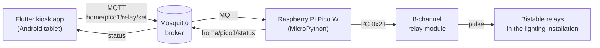

# Relay Panel

A wall-mounted touch panel for controlling home lighting. A Raspberry Pi Pico W switches an 8-channel relay module over I²C, while an Android tablet running a Flutter kiosk app sends commands to it over MQTT. The enclosure is designed in OpenSCAD and 3D-printed.



## Features

- **Firmware (MicroPython)** — drives the relay module through an I²C port expander (active-low outputs), connects to WiFi and listens for JSON commands over MQTT, with connection retries and status reporting.
- **Kiosk app (Flutter)** — full-screen panel with ON/OFF buttons per light, plus a debug page for toggling each of the 8 relays directly.
- **Bistable relay support** — each light uses a pair of relays (ON / OFF); the app sends a 300 ms pulse instead of holding a state.
- **Real kiosk mode on Android** — immersive UI, `startLockTask()` blocks Home/Recents, auto-start after boot, PIN-protected exit.
- **Always responsive** — instead of letting Android turn the screen off (which disables the touch digitizer), the app dims the screen after 15 s of inactivity; the first tap wakes it without triggering a button.
- **Self-healing connection** — automatic MQTT reconnect on disconnect, on app resume and on touch.
- **3D-printed enclosure** — parametric OpenSCAD model (case top, bottom, wall mount).
- **Fully local** — no cloud services; everything runs on the home network.

## Repository layout

```
relay-panel/
├── firmware/             MicroPython code for the Raspberry Pi Pico W
│   ├── main.py           MQTT → I²C relay controller
│   ├── lcd.py            HD44780 driver over PCF8574 (I²C LCD backpack)
│   ├── config.example.py WiFi / broker settings template
│   └── tests/            bring-up scripts: I²C scan, relay sweep, LCD, WiFi, TCP, MQTT
├── app/                  Flutter kiosk app (Android is the target platform)
│   └── lib/main.dart
├── broker/               Mosquitto broker for local development (Docker Compose)
└── enclosure/            OpenSCAD sources, STL files and FreeCAD helper scripts
```

## MQTT protocol

| Topic | Direction | Payload |
|---|---|---|
| `home/{DEVICE_ID}/relay/set` | app → Pico | `{"relay": 0-7, "state": true/false}` |
| `home/{DEVICE_ID}/status` | Pico → app | `online`, `relay 2 -> ON`, `ERR ...` |

Relay-to-light mapping (in `app/lib/main.dart`):

| Light | ON relay | OFF relay |
|---|---|---|
| 1 | IN1 | IN2 |
| 2 | IN3 | IN4 |
| 3 | IN5 | IN6 |

## Hardware

- Raspberry Pi Pico W — I²C1 on **GP26 (SDA)** / **GP27 (SCL)**, 100 kHz
- 8-channel relay module with an I²C expander at address **0x21** (active-low)
- Optional 16×2 LCD with an I²C backpack at **0x27** (used by the test scripts)
- Android tablet as the wall display

## Getting started

### 1. Broker

```bash
cd broker
docker compose up -d        # Mosquitto on port 1883
```

The development config allows anonymous access — restrict it before using the broker outside a trusted LAN.

### 2. Firmware

```bash
cd firmware
cp config.example.py config.py   # fill in WiFi and broker IP
```

Upload `main.py`, `lcd.py` and `config.py` to the Pico (e.g. with the MicroPico VS Code extension or `mpremote`), and install the MQTT client on the board:

```python
import mip
mip.install("umqtt.simple")
```

The scripts in `tests/` are useful for hardware bring-up — start with `i2c_search.py` and `relay_i2c_test.py` to confirm the relay module responds.

### 3. Kiosk app

```bash
cd app
flutter pub get
flutter build apk --dart-define=MQTT_BROKER=192.168.1.10 --dart-define=KIOSK_PIN=1234
```

To exit kiosk mode, press Back and enter the PIN. For lock-task mode without the system pinning prompt, the app has to be set as the device owner on the tablet.

### 4. Enclosure

Dimensions are set in `enclosure/params.scad`; `case_top.scad` and `case_bottom.scad` generate the parts. Ready-to-slice STL files are included.

## Tech stack

MicroPython · Raspberry Pi Pico W · I²C · MQTT (Mosquitto) · Flutter / Dart · Kotlin (Android platform channel) · Docker · OpenSCAD · FreeCAD
